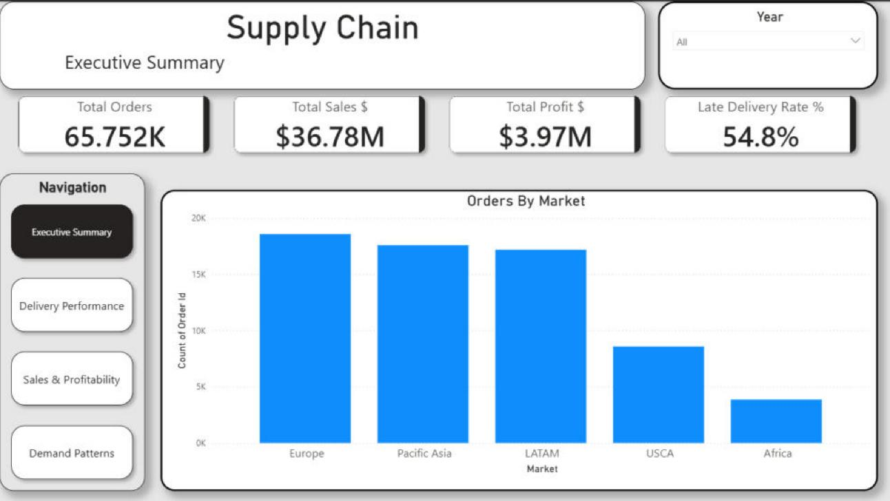
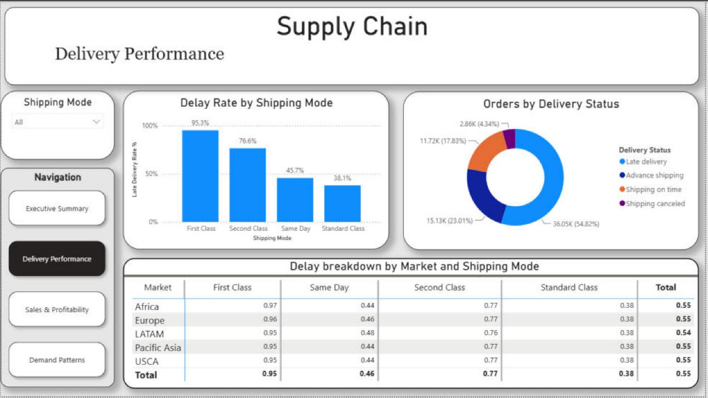
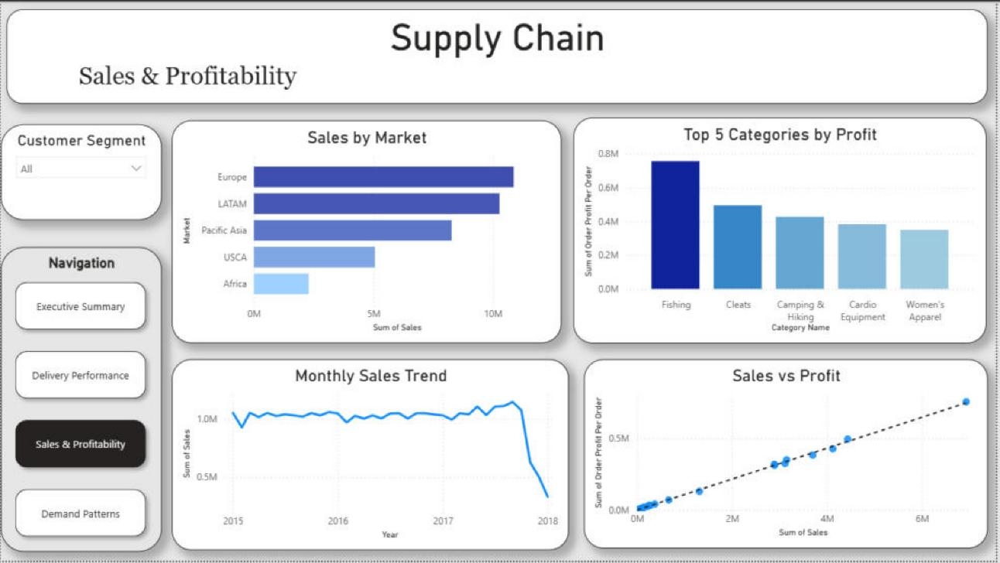
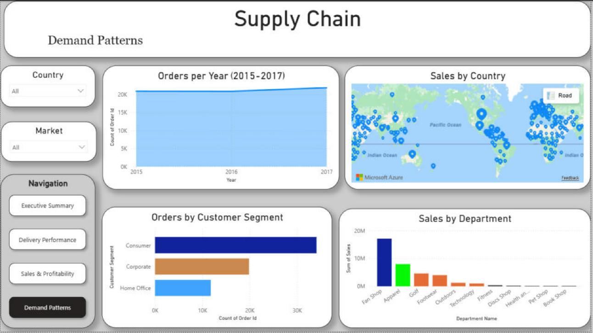

# 🚚 Supply Chain Automation Pipeline

An end-to-end data automation project using Python, SQLite, SQL, and Power BI.

## 📊 Project Overview
An automated pipeline that ingests raw supply chain data, cleans it, loads it into a SQLite database, runs SQL business analysis, and writes a timestamped summary report. The cleaned data also powers a 4-page Power BI dashboard.

📄 **Read the [Executive Summary](EXECUTIVE_SUMMARY.md)** for the business findings and recommendations.

## 🗂️ Dataset
- **Source:** [DataCo Smart Supply Chain Dataset (Kaggle)](https://www.kaggle.com/datasets/shashwatwork/dataco-smart-supply-chain-for-big-data-analysis)
- **Size:** 65,752 orders (180,519 order lines, one row per item) · 53 columns
- **Period:** January 2015 – January 2018

## 🔧 Tech Stack
| Tool | Purpose |
|---|---|
| Python (pandas) | Data cleaning & automation |
| SQLite + SQLAlchemy | Database storage |
| SQL | Business analysis queries |
| Power BI | Interactive dashboard |
| Jupyter Notebook | Exploration & development |

## ⚙️ How It Works
All steps run from a single script, `scripts/automation_pipeline.py`:

```
Raw CSV → clean_data() → SQLite DB → run_analysis() → generate_report() → summary_report.txt
```

1. **Clean:** drops unused and sensitive columns (customer passwords and emails), fills missing customer fields, and converts order and shipping dates to datetime
2. **Load:** writes the cleaned data to a SQLite database with SQLAlchemy
3. **Analyze:** runs 4 SQL queries (late delivery rate by shipping mode, sales and profit by market, top 5 profitable categories, monthly orders and items sold). Orders are counted with `COUNT(DISTINCT "Order Id")`, since each row is one item in an order
4. **Report:** saves the results to `data/summary_report.txt` with a timestamp

## 🚀 How to Run
1. Clone the repo
2. Download `DataCoSupplyChainDataset.csv` from the Kaggle link above and place it in the `data/` folder (the raw file is too large for GitHub, so it is excluded)
3. Install dependencies: `pip install pandas sqlalchemy`
4. From the project root, run: `python scripts/automation_pipeline.py`
5. Check `data/summary_report.txt` for results

## 📈 Key Insights
- **54.8%** of orders are delivered late (57.3% if cancelled orders are left out)
- **First Class** has the worst late rate at **95.3%**, compared with 38.1% for Standard Class. First Class is always scheduled for 1-day delivery, so almost any order that takes longer counts as late
- **Europe** is the highest revenue market at **$10.9M**
- **Fishing** is the most profitable category at **$756K** (19% of all profit)
- Starting in **October 2017**, orders contain about 1 item instead of several. The number of orders stayed about the same, but items sold and monthly revenue dropped sharply

## 📁 Structure
```
├── data/
│   └── summary_report.txt      ← generated by the pipeline
├── notebooks/
│   └── exploration.ipynb       ← exploration & development
├── scripts/
│   └── automation_pipeline.py  ← clean → load → analyze → report
├── sql/
│   └── queries.sql             ← analysis queries
├── dashboard/
│   └── supply_dashboard.pbix   ← Power BI dashboard
├── images/                     ← dashboard screenshots
├── EXECUTIVE_SUMMARY.md        ← findings & recommendations
└── README.md
```

## 📸 Dashboard Preview

### Executive Summary


### Delivery Performance


### Sales & Profitability


### Demand Patterns

